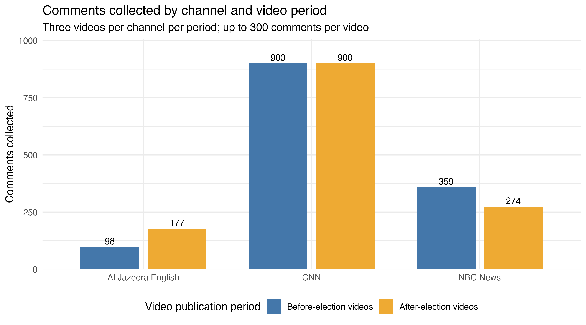
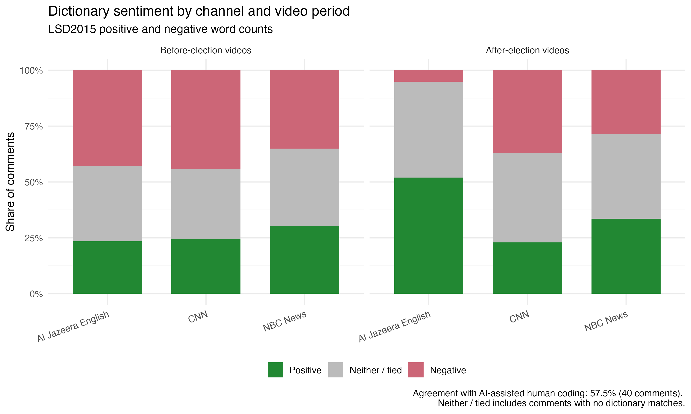

## Report


This collection examines comments on 2026 US midterm election coverage by NBC News, CNN, and Al Jazeera English, representing a national network, cable news, and an international broadcaster. All requests were made on November 10. “Before” and “after” primarily identify video publication periods, not separate collection waves. This retrospective design cannot reconstruct what comment sections looked like before Election Day.

I searched “US midterm election” using relevance and view-count rankings, requesting 100 videos per ordering. The publication windows were September 1–October 27 and November 4–November 10. Both rankings returned 100 rows without duplicate video IDs, while reporting approximately one million available results. Only 24 videos overlapped before the election and 29 afterward. Before the election, Al Jazeera led relevance results with 16 videos, whereas CNN led view-count results with 38. These differences demonstrate that search rankings select different coverage rather than provide a random sample.

Channel uploads supplied an alternative route. An initial 200-video request per channel reached only November 6–7; expanded 6,000-video requests reached September 1 for all three. The broad title filter also captured foreign elections and a university faculty senate. Reviewing 20 retained and 20 excluded titles motivated a narrower filter. Generic program titles could still conceal relevant coverage. Ten candidates per channel and period were randomly drawn with seed 6302 and reviewed; the first three were selected before inspecting comment counts.

The resulting 18 videos yielded 2,708 unique comments, capped at 300 per video. All collection logs recorded success. CNN reached the cap on every selected video, producing 1,800 comments; Al Jazeera contributed 275 and NBC 633. Smaller sections matched their reported totals. For capped sections, the cap explains an observed shortfall; moderation, deletion, replies, and changing counts remain possible general sources of mismatch. Missing video IDs in some returned replies were repaired using the request’s video ID before joining metadata.

A comment section is therefore a sample of visible participation under these videos, conditional on access and moderation. People who watched without commenting are absent, and prolific authors can contribute several observations. Channel differences also combine topic selection with audience responses. Consequently, neither the raw counts nor the lexical comparisons identify a causal election effect. Comparing different videos before and after the election does not hold their subjects or audiences constant.

Participation and attention were uneven. The most active 10% of identified authors produced 22.7% of comments, while the top approximately 1% of comments received 43.8% of likes. Twenty-three repeated text groups contained 60 comments. These counts do not establish automated or coordinated behavior. NBC’s after-period videos had a 33.9% reply share, compared with CNN’s 2.2%, but selected topics and collection caps limit comparisons.

The quanteda unit was one comment. URLs and mentions were removed; emoji and non-English text were retained. Context reading distinguished party references, political support, procedural discussion, grievances, and uses of “democratic” unrelated to party identity. Required phrases were compounded alongside “vote blue” and “voter fraud.” Keyness emphasized celebration and Michigan in Al Jazeera comments and interview subjects in NBC comments. CNN’s leading Arabic features originated in only three comments, with 552 occurrences. Excluding those comments shifted the ranking toward laughter, Mississippi, and ridicule, demonstrating sensitivity to concentrated repetition.

LSD2015 classified 52.0% of Al Jazeera’s after-period comments as positive, versus 23.5% before. However, AI-assisted human coding of 40 randomly selected comments agreed with the dictionary on only 57.5%, below a 70% majority-class baseline in that sample. Sarcasm, political endorsements, abbreviations, mixed evaluations, and non-English text complicate interpretation. Zero or tied dictionary scores do not demonstrate emotional neutrality. These results describe lexical classifications, not validated changes in voter sentiment.

Assignment 6’s archived Biden–Xi tweets represent platform users selected by keywords and timing; their original collection cannot be repeated through the same access. Presidential documents mentioning Xi represent institutionally produced communication selected by publication practices and a query, supporting claims about government discourse. YouTube comments instead reflect self-selected participants under selected videos, shaped by audiences, moderation, ranking, and collection time. Public reads may be repeated, but exact results will change. None of these corpora alone represents public opinion. Retained code, manifests, and aggregates document the procedure while raw YouTube data must be deleted by December 10.


## Figures


{width=95%}


{width=95%}


## Collection and quota documentation


### Search comparison


| period | relevance_received | viewCount_received | overlap |
| --- | --- | --- | --- |
| before | 100 | 100 | 24 |
| after | 100 | 100 | 29 |


Each of the four searches reported `total_results = 1000000`; each returned 100 rows with zero duplicate video IDs. The estimate is not a verified census of relevant videos. Before relevance/view-count leaders were Al Jazeera English (16)/CNN (38); after leaders were Al Jazeera English (10)/CNN (17).


### Planned requests


| task | endpoint | max_results | planned_pages | planned_search_calls | planned_data_units | note |
| --- | --- | --- | --- | --- | --- | --- |
| Before: relevance | search.list | 100 | 2 | 2 | NA | NA |
| Before: viewCount | search.list | 100 | 2 | 2 | NA | NA |
| Channel details | channels.list | 3 | 1 | 0 | 1 | NA |
| Al Jazeera English | playlistItems.list | 200 | 4 | 0 | 4 | NA |
| CNN | playlistItems.list | 200 | 4 | 0 | 4 | NA |
| NBC News | playlistItems.list | 200 | 4 | 0 | 4 | NA |
| Extended uploads: Al Jazeera English | playlistItems.list | 6000 | 120 | 0 | 120 | NA |
| Extended uploads: CNN | playlistItems.list | 6000 | 120 | 0 | 120 | NA |
| Extended uploads: NBC News | playlistItems.list | 6000 | 120 | 0 | 120 | NA |
| Before: selected video statistics | videos.list | 9 | 1 | 0 | 1 | NA |
| Before: comments from 9 videos | commentThreads.list + comments.list | 2700 | 27 | 0 | 27 | Base estimate; reply pagination may require extra calls |
| After: relevance | search.list | 100 | 2 | 2 | 0 | NA |
| After: viewCount | search.list | 100 | 2 | 2 | 0 | NA |
| After: selected video statistics | videos.list | 9 | 1 | 0 | 1 | NA |
| After: comments from 9 videos | commentThreads.list + comments.list | 2700 | 27 | 0 | 27 | Base estimate; reply pagination may require extra calls |


Plans were added before each collection stage. `NA` in the first search rows means data-bucket units were not entered; those requests used the separate search bucket. Comment estimates allow three base pages per video and may require additional reply calls, or fewer calls for short sections.


### Recorded usage


| bucket | quota_used | quota_limit | quota_remaining |
| --- | --- | --- | --- |
| data | 417 | 10000 | 9583 |
| search | 8 | 100 | 92 |
| video_uploads | 0 | 100 | 100 |


The submitted plan totals 8 search calls and 429 data units excluding the unspecified data entries on the first two search rows. The session estimate recorded 8 search calls and 417 data units. Uploads and channel details accounted for 373 data units, video statistics for 2, and comment collection for 42. Short sections made the combined comment estimate of 54 higher than the 42 actually used. These figures follow the course script and recorded tuber counters.


### Upload coverage and title selection


| Channel | Initial oldest date (200) | Expanded oldest date (6,000) | Upload pages requested, total |
| --- | --- | --- | --- |
| Al Jazeera English | 2026-11-07 | 2026-07-17 | 4 + 120 = 124 |
| CNN | 2026-11-06 | 2026-05-28 | 4 + 120 = 124 |
| NBC News | 2026-11-06 | 2026-07-13 | 4 + 120 = 124 |


Each expanded request crossed September 1. These are total pages spent, including duplicated initial coverage, not the minimum number needed to reach the boundary; that crossing-page count was not logged.


| Channel | Before broad-filter matches | Absent from both before searches | Before refined candidates | After refined candidates |
| --- | --- | --- | --- | --- |
| Al Jazeera English | 215 | 196 | 94 | 52 |
| CNN | 160 | 131 | 98 | 47 |
| NBC News | 150 | 146 | 85 | 60 |


The broad-filter matches absent from search include irrelevant videos and are not counts of verified US election videos. Of 20 retained titles reviewed, seven concerned foreign elections or a faculty senate. Twenty dropped titles were also read; generic broadcasts could contain missed election coverage.


Initial filter: `midterm|election|senate|house race|ballot`.

Refined candidate filter (case-insensitive):


```text
midterm|\b(senate|house|congressional)\b.*\b(race|races|control|majority)\b|\b(race|races|control|majority)\b.*\b(senate|house|congressional)\b
```


### Per-video collection log


| period | channel_title | video_id | status | n | comment_count | collected_at |
| --- | --- | --- | --- | --- | --- | --- |
| before | Al Jazeera English | CEZh2RcY9xM | ok | 42 | 42 | 2026-11-10 23:11:16 UTC |
| before | Al Jazeera English | uRE2tPakatM | ok | 51 | 51 | 2026-11-10 23:11:16 UTC |
| before | Al Jazeera English | ytwCEKifhc4 | ok | 5 | 5 | 2026-11-10 23:11:16 UTC |
| before | CNN | NOv-GsiXcI0 | ok | 300 | 455 | 2026-11-10 23:11:16 UTC |
| before | CNN | yy5blvw2IF4 | ok | 300 | 11863 | 2026-11-10 23:11:16 UTC |
| before | CNN | xVvXoy1iMUQ | ok | 300 | 1720 | 2026-11-10 23:11:16 UTC |
| before | NBC News | cuvwOA7fhGc | ok | 51 | 51 | 2026-11-10 23:11:16 UTC |
| before | NBC News | EpFW-U2_2vc | ok | 300 | 483 | 2026-11-10 23:11:16 UTC |
| before | NBC News | rN0NzDme7-s | ok | 8 | 8 | 2026-11-10 23:11:16 UTC |
| after | Al Jazeera English | MBQNTmAAJCo | ok | 2 | 2 | 2026-11-10 23:19:10 UTC |
| after | Al Jazeera English | zC9bW0qsox0 | ok | 9 | 9 | 2026-11-10 23:19:10 UTC |
| after | Al Jazeera English | TaWpOBhmpUs | ok | 166 | 166 | 2026-11-10 23:19:10 UTC |
| after | CNN | dy7RW6cueoU | ok | 300 | 2160 | 2026-11-10 23:19:10 UTC |
| after | CNN | b6MqUPQ2vJs | ok | 300 | 3005 | 2026-11-10 23:19:10 UTC |
| after | CNN | VCo_ECf41-Q | ok | 300 | 1153 | 2026-11-10 23:19:10 UTC |
| after | NBC News | olpJlNmb6Zo | ok | 166 | 166 | 2026-11-10 23:19:10 UTC |
| after | NBC News | 51Dz0-PImAI | ok | 31 | 31 | 2026-11-10 23:19:10 UTC |
| after | NBC News | 9-n0TxhxYEc | ok | 77 | 77 | 2026-11-10 23:19:10 UTC |


All 18 videos were `ok`; `disabled`, `none`, and `error` each occurred zero times in this selected set. No selected channel disabled comments on these videos. That does not establish channel-wide practice. Statistics were requested before the comments; timestamps in the logs mark batch completion. Seven videos reached the 300-comment cap.


### Participation, attention, and duplicates


| channel_title | period | comments | replies | reply_share |
| --- | --- | --- | --- | --- |
| Al Jazeera English | after | 177 | 10 | 0.05649717514124294 |
| Al Jazeera English | before | 98 | 10 | 0.10204081632653061 |
| CNN | after | 900 | 20 | 0.022222222222222223 |
| CNN | before | 900 | 132 | 0.14666666666666667 |
| NBC News | after | 274 | 93 | 0.33941605839416056 |
| NBC News | before | 359 | 52 | 0.14484679665738162 |


| total_likes | median_likes | p90_likes | max_likes | top_1pct_comments | top_1pct_like_share |
| --- | --- | --- | --- | --- | --- |
| 4445 | 0 | 3 | 170 | 28 | 0.437570303712036 |


| identified_authors | comments_with_author_id | comments_without_author_id | top_10pct_author_share |
| --- | --- | --- | --- |
| 2319 | 2708 | 0 | 0.2274741506646972 |


| repeated_text_groups | comments_in_repeated_groups | extra_duplicate_copies |
| --- | --- | --- |
| 23 | 60 | 37 |


Shares are proportions. The top 1% comprises 28 comments; the top 10% of authors comprises 232 authors. Exact-text repetition counts are descriptive and do not identify bots.


## Text analysis details

### Context reading and phrases


Twenty matching contexts per pattern (`democrat*`, `republican*`, `trump`, `vote*`, `ballot*`) were reviewed before keyness. These were first matching occurrences in corpus order, not random independent comments; some long comments contributed several contexts.

The preliminary `democrat*` tally assigned 10 contexts to party references/support/strategy, five to grievance, three to legislative procedure, and two to democracy/political-system terminology. Other patterns were reviewed qualitatively: Republican references included party criticism and procedural discussion; Trump references expressed support or criticism; vote references included mobilization and fraud allegations; ballot references concerned mail voting and counting. A subsequent AI-assisted descriptive tally for all five patterns is provided below. Each occurrence receives one provisional primary function; clipped windows and mixed sentiment make boundary cases uncertain. The categories describe the reviewed contexts, not population proportions. Fraud allegations are commenters’ claims, not verified findings.


| Pattern | Party/candidate reference or stance | Grievance/criticism | Process/procedure | Other political-system usage |
| --- | --- | --- | --- | --- |
| democrat* | 10 | 5 | 3 | 2 |
| republican* | 3 | 8 | 9 | 0 |
| trump | 4 | 16 | 0 | 0 |
| vote* | 9 | 8 | 3 | 0 |
| ballot* | 3 | 6 | 11 | 0 |

| phrase | frequency |
| --- | --- |
| house majority | 0 |
| senate race | 2 |
| early voting | 0 |
| mail in | 5 |
| election fraud | 5 |
| vote blue | 18 |
| voter fraud | 7 |


Two added phrases, `vote blue` and `voter fraud`, came from context reading. Zero counts mean no exact contiguous phrase match under this tokenization. Stopwords were removed after phrase compounding for keyness; sentiment used the original lowercase tokens, retaining stopwords. Emoji were retained, while URLs, mentions, and punctuation were removed for token analysis.


### Channel keyness


Positive chi-square statistics identify target-enriched features. Each target channel is compared against the other two; reversing target and reference reverses the direction of enrichment. These statistics are descriptive because comments and repeated tokens are not independent random samples.


#### Al Jazeera English


| Feature | Signed chi-square | Target count | Reference count |
| --- | --- | --- | --- |
| 🎉 | 969.74 | 91 | 39 |
| ❤ | 907.20 | 89 | 43 |
| congratulations | 593.65 | 43 | 5 |
| allah | 175.56 | 12 | 0 |
| michigan | 170.47 | 15 | 4 |
| alhamdulillah | 159.58 | 11 | 0 |
| 🌹 | 143.60 | 10 | 0 |
| 🤲 | 127.63 | 9 | 0 |
| congrats | 97.61 | 8 | 1 |
| sayed | 97.24 | 10 | 4 |


#### CNN


| Feature | Signed chi-square | Target count | Reference count |
| --- | --- | --- | --- |
| فى | 55.60 | 135 | 0 |
| على | 28.36 | 69 | 0 |
| احداث | 27.13 | 66 | 0 |
| سينمائية | 27.13 | 66 | 0 |
| القربان | 25.89 | 63 | 0 |
| 😂 | 21.01 | 306 | 69 |
| ارض | 20.95 | 51 | 0 |
| الواقع | 20.95 | 51 | 0 |
| تحدث | 20.95 | 51 | 0 |
| mississippi | 18.73 | 80 | 7 |


#### NBC News


| Feature | Signed chi-square | Target count | Reference count |
| --- | --- | --- | --- |
| raskin | 205.47 | 62 | 0 |
| chuck | 98.02 | 34 | 3 |
| jamie | 65.27 | 21 | 0 |
| schumer | 50.92 | 32 | 16 |
| leader | 38.02 | 30 | 20 |
| 🙏 | 36.33 | 16 | 3 |
| hud | 35.52 | 12 | 0 |
| piker | 32.22 | 11 | 0 |
| democratic | 29.56 | 29 | 24 |
| 🌊 | 29.43 | 27 | 21 |


### Video publication period keyness


#### After-publication enriched


| Feature | Signed chi-square | After count | Before count |
| --- | --- | --- | --- |
| 🎉 | 159.42 | 123 | 7 |
| mississippi | 128.77 | 87 | 0 |
| ❤ | 94.50 | 108 | 24 |
| congratulations | 70.96 | 48 | 0 |
| florida | 51.20 | 45 | 5 |
| colom | 50.24 | 34 | 0 |
| jd | 43.93 | 32 | 1 |
| scott | 41.37 | 28 | 0 |
| chuck | 40.82 | 34 | 3 |
| black | 32.14 | 28 | 3 |


#### Before-publication enriched


| Feature | Signed chi-square | After count | Before count |
| --- | --- | --- | --- |
| فى | -91.81 | 0 | 135 |
| على | -46.83 | 0 | 69 |
| احداث | -44.79 | 0 | 66 |
| سينمائية | -44.79 | 0 | 66 |
| trump | -43.00 | 77 | 259 |
| القربان | -42.75 | 0 | 63 |
| raskin | -42.07 | 0 | 62 |
| ارض | -34.60 | 0 | 51 |
| الواقع | -34.60 | 0 | 51 |
| تحدث | -34.60 | 0 | 51 |


### Sensitivity to three repetitive comments

All 552 occurrences of the selected Arabic features came from three before-period CNN comments (184 each). Only these three documents were excluded in the sensitivity check; the main analysis retained all 2,708 comments. This is not a language-wide exclusion or a spam classification.


#### CNN after excluding three documents


| Feature | Signed chi-square | Target count | Reference count |
| --- | --- | --- | --- |
| 😂 | 28.41 | 306 | 69 |
| mississippi | 21.58 | 80 | 7 |
| 🤡 | 18.95 | 42 | 0 |
| cnn | 14.89 | 33 | 0 |
| shit | 12.18 | 27 | 0 |
| jd | 12.12 | 32 | 1 |
| idiots | 11.27 | 25 | 0 |
| called | 10.82 | 24 | 0 |
| ha | 10.37 | 23 | 0 |
| và | 10.37 | 23 | 0 |


#### Before-publication enrichment after excluding three documents


| Feature | Signed chi-square | Target count | Reference count |
| --- | --- | --- | --- |
| trump | -56.51 | 77 | 259 |
| raskin | -47.09 | 0 | 62 |
| vote | -41.84 | 43 | 163 |
| house | -20.38 | 8 | 50 |
| iran | -18.12 | 5 | 39 |
| và | -17.45 | 0 | 23 |
| going | -16.16 | 31 | 92 |
| jamie | -15.93 | 0 | 21 |
| news | -15.60 | 3 | 30 |
| các | -15.17 | 0 | 20 |


### Sentiment and validation


| channel_title | period | comments | positive_share | negative_share | neither_share | no_match_share |
| --- | --- | --- | --- | --- | --- | --- |
| Al Jazeera English | after | 177 | 0.519774011299435 | 0.05084745762711865 | 0.4293785310734463 | 0.4124293785310734 |
| Al Jazeera English | before | 98 | 0.23469387755102042 | 0.42857142857142855 | 0.336734693877551 | 0.25510204081632654 |
| CNN | after | 900 | 0.23 | 0.3711111111111111 | 0.3988888888888889 | 0.29333333333333333 |
| CNN | before | 900 | 0.24444444444444444 | 0.44222222222222224 | 0.31333333333333335 | 0.20666666666666667 |
| NBC News | after | 274 | 0.3357664233576642 | 0.2846715328467153 | 0.3795620437956204 | 0.28832116788321166 |
| NBC News | before | 359 | 0.30362116991643456 | 0.35097493036211697 | 0.34540389972144847 | 0.2646239554317549 |


The score is positive matches minus negative matches using only LSD2015’s `positive` and `negative` keys. Negation-specific keys were not applied. A positive score is labeled positive, a negative score negative, and a zero score neither/tied. English lexical coverage does not capture all emoji, non-English content, negation, or sarcasm.


| n | agreed | agreement_rate | majority_class_baseline |
| --- | --- | --- | --- |
| 40 | 23 | 0.575 | 0.7 |


| human_label | dictionary_label | n |
| --- | --- | --- |
| negative | negative | 16 |
| negative | neither | 9 |
| negative | positive | 3 |
| neither | neither | 4 |
| neither | positive | 3 |
| positive | neither | 2 |
| positive | positive | 3 |


Forty comments were selected with seed 6302 after sorting comment IDs. Labels describe overall expressed tone, not partisan correctness: positive for support/praise/celebration, negative for criticism/anger/distrust, and neither for neutral, mixed, or unclear tone. ChatGPT proposed interpretations and labels; the user entered them. This is AI-assisted coding, not an independent blinded human benchmark. The displayed 57.5% is agreement with those labels. Manual negative labels numbered 28 of 40, yielding the 70% majority baseline.


### Timing distinction


| Video publication period | Comment date before Nov. 3 | Comment date Nov. 3 | Comment date after Nov. 3 |
| --- | --- | --- | --- |
| before | 1321 | 13 | 23 |
| after | 0 | 0 | 1351 |


All date bins are UTC. Main period results compare video-publication groups. A comparison of actual comment dates would be a different analysis. The assignment’s prospective before/after collection requirement was not fulfilled: both groups were collected retrospectively on November 10.


## Comparison with Assignment 6


| Source | Producer and intended audience | Selection | Can it be collected again? | Supported claim |
| --- | --- | --- | --- | --- |
| 2021 Biden–Xi tweets | Platform users addressing followers and wider publics | Summit keywords, timing, original API coverage | Archived dataset can be reused; original access cannot be recreated as described in Assignment 6 | Discourse among captured platform users, not representative public opinion |
| CPD documents mentioning Xi | Presidential administration addressing public and institutional audiences | Official publication/editorial practices and the Xi Jinping query | Public archive can be queried again; revisions and query timing may change results | Official government communication |
| 2026 midterm YouTube comments | Self-selected participants addressing channels and other commenters | Video topic, channel, title filters, moderation, ranking, cap and collection time | Public API requests can be repeated within access/quota rules; exact comments may change | Comments returned for these selected videos and audiences, not voters in general |


## Data note and reproduction

Data were collected through the YouTube Data API v3 using an API key and a quota plan. The key, raw comments, and commenter identifiers are not published. Raw API data and validation files containing comment text will be deleted by December 10, 2026.

The query was `US midterm election`, with 100 results requested for both `relevance` and `viewCount` orderings. Video publication windows were September 1–October 27 and November 4–10, 2026. Title-filtered uploads from Al Jazeera English, CNN, and NBC News supplied candidates. Using seed 6302, ten candidates per channel and period were sampled and reviewed; the first three were selected, with up to 300 comments collected per video. Exact settings are recorded in the manifests.

All comments were collected on November 10, so “before” and “after” refer to video publication dates. Title filters, moderation, deletion, comment ordering, language, and collection caps limit coverage. These comments do not represent all viewers or voters. Repeated API requests may return different results.

The [collection script](scripts/assign07_recollect.R) and
[analysis script](scripts/assign07_analysis.R) document the workflow.
Aggregate results are presented above.

### Collection records

- [Collection log](outputs/collection_log.csv)
- [Before-period manifest](outputs/manifest_before.json)
- [After-period manifest](outputs/manifest_after.json)

